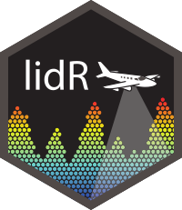

## Overview

::: {.columns valign="center"}
::: {.column width="17%"}
{width=100% fig-alt="lidR package logo"}
:::

::: {.column width="5%"}
:::

::: {.column width="78%"}
This section introduces the use of the `lidR` R package for processing airborne laser scanning (ALS) data and deriving information relevant to forest inventory. The tutorials are organized as a sequence of independent topics, from reading point-cloud data to area-based and individual-tree approaches.
:::
:::

## Tutorial materials

The following pages will be developed as the tutorial progresses. Each currently serves as a placeholder for examples, code, and exercises.

| Tutorial | Topic |
|---|---|
| [1-LAS](1-LAS.qmd) | Reading, exploring, and filtering LAS/LAZ point clouds |
| [2-DTM](2-DTM.qmd) | Digital terrain models and height normalization |
| [3-CHM](3-CHM.qmd) | Canopy height models |
| [4-METRICS](4-METRICS.qmd) | Point-cloud and canopy metrics |
| [5-LASCATALOG](5-LASCATALOG.qmd) | Processing collections of LiDAR files |
| [6-ROI](6-ROI.qmd) | Working with regions of interest |
| [7-ABA](7-ABA.qmd) | Area-based approaches to forest inventory |
| [8-ITS](8-ITS.qmd) | Individual-tree detection and segmentation |

## Requirements

### R and RStudio

A recent version of [R](https://www.r-project.org/) is required. [RStudio](https://posit.co/download/rstudio-desktop/) is recommended for working through the examples.

### R packages

Install `lidR` to get started:

```r
install.packages("lidR")
```

Additional packages and datasets will be listed within the individual tutorials as needed.

## Resources

- [Official `lidR` package documentation](https://cran.r-project.org/package=lidR)
- [lidRbook](https://r-lidar.github.io/lidRbook/)
- [lidR source code](https://github.com/r-lidar/lidR)
- [GIS Stack Exchange questions tagged `lidr`](https://gis.stackexchange.com/questions/tagged/lidr)

## About `lidR`

`lidR` is an open-source R package for analyzing airborne LiDAR point clouds, creating raster products, and extracting forest structure information. The pages in this section focus on its applications to forest inventory. The package was developed at Université Laval in Québec, Canada, and is maintained by [Jean-Romain Roussel](https://github.com/Jean-Romain). The current release is available on [CRAN](https://cran.r-project.org/package=lidR), and its source code is hosted on [GitHub](https://github.com/r-lidar/lidR).

## r-lidar

The [r-lidar](https://www.r-lidar.com/) organization supports the continued sustainability of the software and offers training, consulting, and development services. `Jean-Romain Roussell` is commited to maintaining the `lidR` packages as fully open source.

{fig-alt="r-lidar banner"}